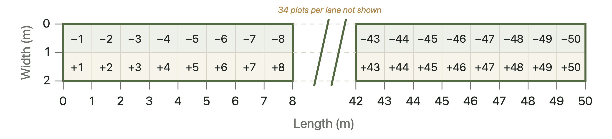

# Post-fire vegetation and microenvironmental data from Andean páramo grasslands

This repository contains original field data and R scripts accompanying:

**Zomer, M. A., & Ramsay, P. M. (2021). Post-fire changes in plant growth form composition and diversity in Andean páramo grassland. *Applied Vegetation Science*, 24, e12554. https://doi.org/10.1111/avsc.12554**

*Reproducibility note (2026): The original field data were reanalysed in R using newly developed scripts.*

### Study overview

Field data were collected in 2015 across 16 páramo sites in northern Ecuador, representing a chronosequence of 0.5–15 years since fire and one site unburned for at least 40 years. Measurements included plant growth-form composition, vegetation height, soil temperature, and light availability.

### Sampling design

At each site, a 50 × 2 m plot was divided into 100 contiguous 1 m² quadrats, arranged in two parallel rows of 50. Quadrats were identified by their position along the transect (1–50) and row (+ or −).

Plant growth-form presence and vegetation height were recorded in each quadrat. Soil temperature was measured under three shading conditions at five positions along the transect, and photosynthetically active radiation (PAR) was measured at 50 sampling points at 1 m intervals.

Further methodological details are provided in Zomer and Ramsay (2021).

### Repository structure

**`data/`**

- `raw/` – Original field data (CSV)
  - `site_information.csv` – Site metadata and fire history
  - `growth_form_raw.csv` – Growth-form occurrence by quadrat
  - `vegetation_height_raw.csv` – Vegetation-height measurements
  - `soil_temperature_raw.csv` – Soil-temperature measurements
  - `par_raw.csv` – Incident PAR and SunScan sensor readings
- `processed/` – Cleaned field-data files

**`outputs/`**

- `summaries/` – Site-level vegetation and environmental summaries
- `models/` – Regression results
- `figures/` – Reproduced regression figures

**`scripts/`**

- `setup.R` – Load packages and set up directories
- `01_data_cleaning.R` – Import and clean field data
- `02_site_summaries.R` – Calculate site-level summaries and diversity metrics
- `03_regressions.R` – Reproduce published regression analyses
- `04_figures.R` – Generate figures

**Documentation**

- `README.md` – Study overview and repository structure
- `README_variables.md` – Variable definitions, units, and coding conventions

### Workflow

Run the numbered R scripts sequentially in RStudio, starting with `setup.R`.
